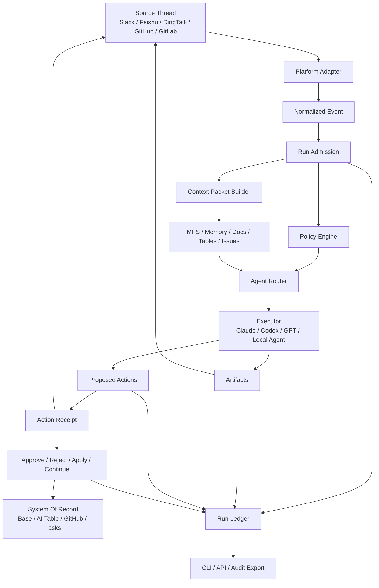

# OS Tag vs Claude Tag: Strategy, Learning Plan, And Product Direction

Date: 2026-07-04  
Status: Proposed strategic direction  
Owner: OS Tag / Loop Engineering

## 1. Executive Summary

Claude Tag is an important signal: the collaboration surface for AI work is
moving from private chat and IDE sidebars into shared work threads. Teams will
increasingly delegate work by tagging an AI teammate inside Slack, Feishu,
DingTalk, GitHub, GitLab, issue trackers, and operational tables.

OS Tag should not try to become a weaker clone of Claude Tag. That would be a
bad strategic position because Claude Tag has model-native advantages,
Anthropic distribution, Slack integration depth, and Claude Code integration.

The correct direction is:

> OS Tag is an open, multi-platform, agent-neutral CLI bot operating system for
> human-agent collaboration.

In simpler words:

> Claude Tag is a strong AI teammate. OS Tag should become the control plane
> where many AI teammates, human teammates, enterprise systems, and work
> threads coordinate safely.

OS Tag remains strategically meaningful even if Claude Tag later opens to more
agents, as long as OS Tag owns these differentiated dimensions:

- agent-neutral orchestration across Claude, Codex, GPT, Gemini, local agents,
  enterprise agents, and future specialized agents;
- platform-neutral operations across Slack, Feishu/Lark, DingTalk, GitHub,
  GitLab, and eventually Discord, Telegram, WhatsApp, WeCom, and other work
  surfaces;
- CLI-first and API-first control for other agents, not only human chat users;
- self-hosted / private deployment for organizations that need local control;
- system-of-record workflows such as requirement tables, tasks, PRs, issues,
  approvals, meeting notes, project boards, customer records, and operations
  ledgers;
- open governance protocols: action receipts, run ledgers, context packets,
  policy decisions, approval records, and audit exports.

## 2. Current Claude Tag Understanding

Anthropic introduced Claude Tag on 2026-06-23. Publicly described capabilities
include:

- Slack-first shared AI teammate.
- Channel-level Claude identity.
- Access to selected channels, tools, data, and codebases.
- Anyone in the channel can tag `@Claude` and delegate tasks.
- Claude remembers relevant information from channels it is in.
- Claude can plan tasks for the future.
- Claude is multiplayer: one Claude instance interacts with everyone in a
  channel.
- Claude learns over time.
- Claude can take initiative when ambient behavior is enabled.
- Claude can work asynchronously and schedule tasks for itself.
- Admins configure which channels, data, and tools Claude can access.
- Memories are scoped to configured channels/use cases.
- Admins can set organization and channel spend limits.
- Admins can view logs of what Claude has done and who requested each task.

Relevant public references:

- Anthropic Claude Tag announcement:
  <https://www.anthropic.com/news/introducing-claude-tag>
- Claude Code in Slack docs:
  <https://code.claude.com/docs/en/slack>
- Claude Slack Marketplace listing:
  <https://slack.com/marketplace/A08SF47R6P4-claude>

## 3. What Claude Tag Gets Right

### 3.1 Source Thread As The Work Surface

Claude Tag treats Slack channels and threads as the natural location for AI
work. This is right. Work already happens in these places. Context, decisions,
people, files, links, and acceptance criteria are often already there.

OS Tag must adopt this principle:

> The source thread is the primary work surface, not a notification endpoint.

Every OS Tag run should be anchored to a source thread or source object:

- Slack thread;
- Feishu/Lark group thread or message;
- DingTalk group conversation;
- GitHub issue or PR comment;
- GitLab issue or merge request note;
- Base / AI table record;
- future: ticket, CRM case, email thread, calendar event.

### 3.2 Multiplayer AI

Claude Tag has a strong product insight: the AI teammate is shared by the team,
not hidden in one user's private chat. Anyone can see the context, pick up the
conversation, review what the AI is doing, and continue the work.

OS Tag must implement this with:

- channel-level memory;
- channel-level policy;
- shared run status;
- visible task stages;
- receipts in the source thread;
- artifact links;
- audit export.

### 3.3 Channel-Scoped Memory

Claude Tag's channel-scoped memory is a key advantage. It avoids both extremes:

- stateless bot that forgets everything;
- global memory that leaks context between teams.

OS Tag should model memory as:

```text
organization
  platform
    channel/thread/project
      facts
      preferences
      policy
      linked systems
      recent runs
      artifacts
      allowed tools
      budgets
```

Important rule:

> Memory must be scoped, inspectable, editable, and deletable.

### 3.4 Ambient Initiative

Claude Tag can proactively flag relevant information and follow up when threads
or tasks go quiet. This is a defining capability. It moves the product from
"chatbot" to "teammate".

OS Tag already has early ambient behavior through requirement table digests.
This must become more general:

- detect unowned requirements;
- detect stale tasks;
- detect blocked work;
- detect missing acceptance criteria;
- detect no update after promised deadline;
- detect conflicting status across chat/table/issue/PR;
- remind managers at configurable times;
- create proposed follow-up actions;
- never spam;
- never silently mutate system-of-record without policy.

### 3.5 Async Multi-Day Work

Claude Tag can work asynchronously over hours or days. This is more than a long
LLM call. It requires task persistence and resumability.

OS Tag needs:

- durable run state;
- queued/running/waiting_approval/blocked/succeeded/failed/cancelled states;
- scheduled continuation;
- deadline and retry policy;
- resumable context packet;
- artifacts that survive process restarts;
- source-thread updates that are concise and useful.

### 3.6 Admin Governance

Claude Tag is designed for teams and organizations. Admins configure access,
spend limits, data/tools, and logs.

OS Tag must treat governance as a first-class product surface, not an afterthought:

- channel policy;
- connector policy;
- action policy;
- actor policy;
- budget policy;
- approval policy;
- memory policy;
- retention policy;
- audit policy.

## 4. Where OS Tag Can Be More Advanced

OS Tag should not claim to be smarter than Claude Tag at raw model reasoning.
That is not the correct battle. OS Tag can be more advanced in architecture,
openness, system integration, and agent interoperability.

### 4.1 Agent-Neutral Control Plane

Claude Tag is Claude-native. OS Tag should be agent-neutral.

Target:

```text
OS Tag
  -> Claude Code
  -> Codex
  -> GPT / OpenAI API
  -> Gemini
  -> local agents
  -> enterprise internal agents
  -> specialized finance/legal/support/dev agents
  -> future Claude Tag / Claude API if available
```

OS Tag should route by:

- task type;
- platform;
- required tools;
- cost;
- latency;
- security level;
- data boundary;
- actor permission;
- model benchmark score;
- organization policy.

If Claude Tag opens to other agents one day, OS Tag still matters if it is the
neutral router and governance layer above those agents.

### 4.2 Platform-Neutral Collaboration

Claude Tag starts with Slack. OS Tag must be collaboration-platform neutral.

Priority platforms:

1. Slack
2. Feishu / Lark
3. DingTalk
4. GitHub
5. GitLab
6. Discord
7. Telegram
8. WhatsApp
9. WeCom / enterprise WeChat
10. email and calendar threads

Each platform adapter should expose a capability map:

```yaml
can_read_thread: true
can_reply_thread: true
can_send_proactive: true
can_render_buttons: false
can_render_cards: true
can_upload_artifact: true
can_mention_users: true
can_schedule_message: false
can_read_files: true
can_apply_action: true
```

OS Tag should degrade gracefully:

- buttons when available;
- cards when available;
- text commands when interactivity is unavailable;
- CLI/API when chat rendering is limited.

### 4.3 CLI-First And Agent-Facing

Claude Tag is primarily human-facing inside Slack. OS Tag should also be
agent-facing.

Required CLI surface:

```bash
ostag doctor
ostag setup
ostag service start
ostag service stop
ostag service status
ostag service logs

ostag run --platform slack --channel C123 --thread 123.456 --json
ostag status --run run_123 --json
ostag context export --run run_123 --json
ostag artifacts list --run run_123 --json
ostag artifacts get artifact_123 --output ./tmp

ostag approve action_123
ostag reject action_123
ostag apply action_123
ostag continue run_123

ostag channel status --platform dingtalk --channel cid...
ostag channel policy show --platform dingtalk --channel cid...
ostag channel policy set --platform dingtalk --channel cid... --ambient true

ostag connector list --json
ostag connector test dingtalk
ostag ambient run-once --platform dingtalk --channel cid...
ostag ledger export --run run_123 --json
```

Agent-facing requirements:

- every command supports `--json`;
- output is compact and stable;
- errors include `code`, `message`, and `recovery_hint`;
- no null/empty noise;
- artifact paths are absolute paths or URLs;
- destructive actions require explicit approval or policy.

### 4.4 System-Of-Record First

Claude Tag is an AI teammate. OS Tag should be an AI operations maintainer.

OS Tag should specialize in keeping real work systems clean:

- requirement tables;
- project boards;
- issue trackers;
- tasks;
- PRs;
- release checklists;
- customer feedback tables;
- meeting action items;
- operational dashboards;
- approval records;
- audit logs.

This is where OS Tag can build depth. A generic AI teammate can answer well,
but a system-of-record maintainer must:

- preserve table schema;
- avoid duplicates;
- update the right record;
- track owners;
- detect stale status;
- reconcile chat vs table vs issue vs PR;
- produce morning and evening digests;
- enforce policies;
- keep audit history.

### 4.5 Open Governance Protocol

OS Tag can define an open protocol for human-agent work:

- `Run`
- `ContextPacket`
- `ActionReceipt`
- `Artifact`
- `PermissionGrant`
- `ApprovalDecision`
- `ApplyPlan`
- `LedgerEvent`
- `ConnectorCapability`
- `PolicyDecision`

If done well, this becomes more durable than any single model vendor feature.

## 5. Strategic Risk: What If Claude Tag Opens To Other Agents?

If Claude Tag eventually becomes an open agent platform, OS Tag's weak forms
become less valuable.

### 5.1 OS Tag Would Lose If It Is Only:

- a Slack bot that calls Claude/Codex;
- a basic chat summarizer;
- a thin wrapper around Claude Code;
- a simple requirement table updater;
- a private clone of Claude Tag without distribution;
- a product with no governance layer;
- a product with no CLI/API for agents.

### 5.2 OS Tag Still Matters If It Becomes:

- a neutral control plane;
- a multi-agent router;
- a cross-platform work-thread operating layer;
- a private deployment option;
- an enterprise connector hub;
- a system-of-record maintainer;
- an auditable agent governance layer;
- a CLI/API used by other agents;
- a bridge for markets/platforms Claude Tag does not serve deeply.

### 5.3 Strategic Framing

Bad framing:

> OS Tag is an open-source Claude Tag alternative.

Better framing:

> OS Tag is an open control plane for human-agent collaboration across chat,
> CLI, enterprise tools, and systems of record.

Best framing:

> OS Tag lets humans and agents delegate, govern, execute, approve, audit, and
> follow up on work from any source thread, using any capable agent, against any
> connected business system.

## 6. Gap Analysis

| Capability | Claude Tag | OS Tag Current Direction | Gap | OS Tag Target |
|---|---|---|---|---|
| Model quality | Native Claude / Claude Code | Backend abstraction | Large | Route to best agent per task |
| Slack UX | Official app, buttons, sessions | Basic Slack adapter | Large | Rich receipts, buttons, thread continuity |
| Feishu/Lark | Not primary | Existing support | OS Tag advantage | Deep Base, Docs, Tasks, approvals |
| DingTalk | Not primary | Existing support | OS Tag advantage | Deep AI Table, docs, group bot, reminders |
| Channel memory | Claude scoped memory | Channel Brain emerging | Medium | Inspectable, editable, exportable memory |
| Ambient mode | Proactive follow-up | 9/18 table digests emerging | Medium | General ambient monitors |
| Async work | Multi-hour/day tasks | Basic scheduler | Large | Durable resumable run lifecycle |
| Governance | Admin tools, spend limits, logs | Policy primitives emerging | Large | Policy engine + receipts + ledger |
| CLI for agents | Not main surface | Should be core | OS Tag advantage if built | Agent-friendly CLI/API |
| Multi-agent routing | Claude-native | Potential | Large | Agent-neutral router |
| Self-hosting | Likely SaaS-led | Local service possible | OS Tag advantage | Full private deployment |
| System-of-record ops | Tool dependent | Requirement table focus | OS Tag advantage | Deep operational workflows |
| Open protocol | Product-internal | Can be open | OS Tag advantage | Publish schemas and docs |

## 7. What OS Tag Must Learn From Claude Tag

### 7.1 Product Interaction

- One AI identity per channel/project.
- Channel users can see and continue the same AI work.
- The AI should report work in stages, not just final answer.
- Source-thread replies should be concise.
- Deep details should live in artifacts/ledger/session views.
- Users should be able to force routing:
  - "treat this as code";
  - "treat this as analysis";
  - "treat this as requirement management";
  - "only propose, do not apply";
  - "run in read-only mode".

### 7.2 Memory

- Memory is scoped.
- Memory is permissioned.
- Memory is useful only if inspectable.
- Memory must not leak between sales/engineering/finance/support.
- Memory should be linked to evidence from source threads and systems.

### 7.3 Ambient Behavior

- Ambient must be opt-in.
- Ambient must cite why it triggered.
- Ambient must be rate-limited.
- Ambient must be suppressible.
- Ambient should follow up on quiet unresolved work.
- Ambient should not create noise.
- Ambient should prefer proposed actions over automatic writes.

### 7.4 Async Task Execution

- Tasks need stages.
- Stages need durable state.
- Users need progress updates.
- Users need a way to cancel, pause, continue, or change scope.
- Long-running work needs artifact checkpoints.

### 7.5 Admin Controls

- Configure data access by channel.
- Configure tool access by channel.
- Configure budget by org/channel.
- Configure memory boundaries.
- Configure auto-apply policy.
- View logs by actor/channel/run.

## 8. What OS Tag Should Learn From OpenTag

Reference repo:

- <https://github.com/amplifthq/opentag>

Key ideas to adopt:

- source-thread-native agent work loop;
- executor-neutral design;
- local-first runtime;
- isolated worktrees;
- admission decisions;
- source-thread action receipts;
- apply / approve / reject / continue;
- artifact-first final replies;
- local work ledger;
- public repo write-access checks;
- read-only sandbox for no-write scope;
- environment secret scrubbing;
- dangerous bypass warnings.

OpenTag should influence OS Tag's governance protocol more than its user-facing
brand. OS Tag should not only "mention an agent"; it should manage authority.

## 9. What OS Tag Should Learn From MFS

Reference repo:

- <https://github.com/zilliztech/mfs>

Key ideas to adopt:

- multi-source context as a file-like namespace;
- memory and skills as searchable sources;
- docs, chat, email, code, databases, object stores under one retrieval layer;
- progressive search/browse/cat workflow;
- local-first setup;
- source connector boundaries;
- allowed-scope access control.

OS Tag should use MFS-style context to build `ContextPacket`.

```text
ContextPacket
  source_thread
  recent_messages
  linked_files
  linked_tables
  linked_issues
  channel_brain
  previous_runs
  relevant_memory
  connector_capabilities
  policy
  actor
  budget
  citations
```

## 10. What OS Tag Should Learn From CopilotKit/OpenTag

Reference repo:

- <https://github.com/CopilotKit/OpenTag>

Key ideas to adopt:

- rich UI in Slack-like surfaces;
- human-in-the-loop gate;
- inline tables/charts/cards;
- approvals before writes;
- thread continuation;
- E2E tests that check what actually renders in Slack;
- restart recovery for pending approval interactions.

OS Tag should implement platform-specific renderers:

- Slack Block Kit renderer;
- Feishu/Lark card renderer;
- DingTalk card/markdown renderer;
- GitHub/GitLab markdown renderer;
- plain text fallback renderer.

## 11. What OS Tag Should Learn From agent-slack

Reference repo:

- <https://github.com/stablyai/agent-slack>

Key ideas to adopt:

- CLI designed for agents, not only humans;
- compact JSON output;
- zero/null field pruning;
- explicit read/write safety boundary;
- `draft` before `send` for risky human-facing messages;
- scheduled messages;
- attachment download to local paths;
- rich text conversion;
- channel/user/message/workflow/canvas primitives;
- skill instructions bundled with the CLI.

OS Tag's CLI should be equally agent-friendly.

## 12. Target Architecture



## 13. Core Data Models

### 13.1 Run

```yaml
run_id: string
source:
  platform: slack | feishu | lark | dingtalk | github | gitlab
  channel_id: string
  thread_id: string
  message_id: string
actor:
  actor_id: string
  display_name: string
  permission_level: read | propose | write | admin
intent:
  raw_text: string
  normalized_type: string
  confidence: number
status: queued | admitted | running | waiting_approval | blocked | succeeded | failed | cancelled
context_packet_id: string
executor_id: string
artifacts: []
actions: []
ledger_events: []
created_at: string
updated_at: string
```

### 13.2 ActionReceipt

```yaml
action_id: string
run_id: string
title: string
target_system: string
target_object: string
mutation_type: create | update | delete | send | schedule | merge | assign
summary: string
diff: string
risk: low | medium | high
required_permissions: []
state: proposed | needs_approval | ready_to_apply | applying | applied | approved_only | rejected | blocked | stale | failed
verification:
  - name: string
    status: pass | fail | skipped
    evidence: string
commands:
  approve: string
  reject: string
  apply: string
  continue: string
```

### 13.3 ConnectorCapability

```yaml
platform: dingtalk
connector: ai_table
capabilities:
  can_read_records: true
  can_write_records: true
  can_create_records: true
  can_delete_records: false
  can_render_buttons: false
  can_send_proactive: true
  can_mention_users: limited
limits:
  batch_size: 30
  rate_limit: unknown
policy:
  default_mode: propose
  destructive_requires_approval: true
```

## 14. Product Principles

1. Do not compete with Claude Tag on being "Claude in Slack".
2. Compete on being open, neutral, auditable, extensible, and system-of-record aware.
3. Every run must be inspectable.
4. Every write must have authority.
5. Every source thread should remain the user-visible collaboration surface.
6. Every artifact should be linkable.
7. Every connector should declare capabilities.
8. Every ambient action should explain why it fired.
9. Every error should include a recovery path.
10. Every CLI command should support agent-readable JSON.

## 15. Roadmap

### Phase 0: Strategy And Benchmark

Deliverables:

- this document;
- updated benchmark against Claude Tag, OpenTag, MFS, CopilotKit/OpenTag,
  agent-slack;
- scorecard and gaps.

### Phase 1: Run Ledger

Implement:

- `Run`;
- `LedgerEvent`;
- local JSONL or SQLite store;
- `ostag status --run`;
- `ostag ledger export`.

Acceptance:

- every inbound event creates a run id;
- every run has source, actor, intent, status, final outcome;
- secrets are redacted.

### Phase 2: Action Receipt Protocol

Implement:

- action receipt schema;
- text renderer;
- parse `approve`, `reject`, `apply`, `continue`;
- stale action detection;
- tests.

Acceptance:

- unsupported interactive platforms get command fallback;
- all writes can be represented as receipts;
- no apply without policy or approval.

### Phase 3: Connector Capability Layer

Implement:

- capability schema;
- adapter capability declaration;
- Slack / Feishu / Lark / DingTalk capabilities;
- connector test command.

Acceptance:

- OS Tag can explain what each platform can and cannot do;
- renderers degrade gracefully.

### Phase 4: CLI For Humans And Agents

Implement:

- `ostag doctor`;
- `ostag run`;
- `ostag status`;
- `ostag channel policy show/set`;
- `ostag artifacts list/get`;
- `ostag approve/reject/apply/continue`;
- `--json` outputs.

Acceptance:

- agent can safely use CLI without parsing prose;
- errors have recovery hints.

### Phase 5: Ambient Mode V2

Implement:

- generalized monitors;
- 9/18 digests;
- stale task detection;
- missing owner detection;
- unresolved thread detection;
- rate limits;
- opt-out;
- audit.

Acceptance:

- no ambient messages when disabled;
- daily digest sends once per window;
- every ambient message cites source data;
- no automatic destructive write.

### Phase 6: MFS Context Provider

Implement:

- `ContextProvider` interface;
- MFS provider;
- local memory provider;
- table provider;
- thread provider;
- context packet export.

Acceptance:

- each run can export its context packet;
- context includes citations to source data.

### Phase 7: Governance And Security Hardening

Implement:

- actor permission model;
- repo write access checks;
- platform/channel policy checks;
- sandbox/worktree execution mode;
- environment scrub;
- dangerous mode warnings;
- security event ledger.

Acceptance:

- read-only actor cannot apply write;
- public repo write requires write actor or allowlist;
- secrets never appear in logs;
- stale approvals are rejected.

## 16. Benchmark Scorecard

Total: 100 points.

| Area | Points | Requirement |
|---|---:|---|
| Source-thread workflow | 10 | Run starts and reports from source thread. |
| Channel memory | 8 | Scoped, inspectable, editable memory. |
| Ambient mode | 8 | Safe proactive reminders and follow-up. |
| Async runs | 8 | Durable multi-stage resumable runs. |
| Action receipts | 12 | Approve/reject/apply/continue protocol. |
| Run ledger | 10 | Auditable run/event/action/artifact history. |
| Agent-neutral routing | 8 | Multiple executors with capability checks. |
| Platform-neutral adapters | 8 | Slack/Feishu/Lark/DingTalk/GitHub/GitLab capability maps. |
| CLI/API for agents | 10 | Compact JSON and stable commands. |
| Security/governance | 12 | Policy, sandbox, secret scrub, permissions. |
| System-of-record workflows | 6 | Tables/tasks/issues/PRs updated safely. |

Automatic failure:

- secret leaked to logs or repo;
- write applied to wrong system-of-record;
- destructive write without explicit approval;
- no audit trail for applied action;
- existing Slack/Feishu/Lark/DingTalk flows broken;
- tests fail;
- actor permissions ignored.

## 17. Product Positioning

### 17.1 Do Not Say

- "OS Tag is a Claude Tag clone."
- "OS Tag is an open-source Claude."
- "OS Tag is just Slack Claude for other platforms."

### 17.2 Say Instead

- "OS Tag is an open control plane for human-agent collaboration."
- "OS Tag lets any capable agent work from any source thread, under explicit
  policy and audit."
- "OS Tag connects chat, CLI, enterprise tools, and systems of record."
- "OS Tag is designed for both humans and agents."

### 17.3 One-Line Pitch

> OS Tag turns any work thread into a governed, auditable, multi-agent work loop.

### 17.4 Longer Pitch

> OS Tag lets teams delegate work from Slack, Feishu, DingTalk, GitHub, GitLab,
> or CLI to the right agent, with scoped context, policy checks, action receipts,
> approvals, artifacts, and audit logs. It maintains systems of record such as
> requirement tables, tasks, issues, pull requests, and project digests while
> keeping humans in control.

## 18. Strategic Conclusion

Claude Tag validates the direction. It proves that shared AI teammates inside
work channels will become a major interface for knowledge work.

But Claude Tag does not make OS Tag meaningless unless OS Tag chooses the wrong
lane.

The wrong lane:

> Build a weaker `@Claude` clone.

The right lane:

> Build the open operating layer where humans, Claude, Codex, GPT, local agents,
> and enterprise systems collaborate safely across every work surface.

OS Tag should respect Claude Tag, learn from it aggressively, and compete by
being more open, more neutral, more inspectable, more self-hostable, more
CLI-native, more system-of-record aware, and more useful in non-Slack enterprise
ecosystems.

The mission is not to beat Claude at being Claude.

The mission is to orchestrate Claude, Codex, other agents, and humans into
reliable work.
