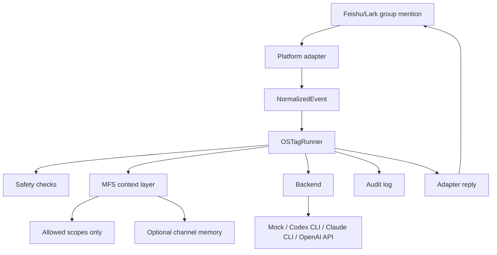

# OS Tag Architecture

OS Tag adapts the Open Tag idea to Feishu/Lark while keeping the agent runner
platform independent.

## Upstream Reference Summary

The upstream `zilliztech/mfs/examples/open-tag-skill` implementation is a Slack
Socket Mode bridge. It receives `app_mention` events, strips the Slack mention,
collects thread text, builds a prompt, optionally uses MFS helper scripts for
authorized context, invokes a CLI backend such as `claude -p` or `codex exec`,
and updates the Slack thread with the answer.

OS Tag keeps the useful pattern: Brain, Memory, and Tools. The key change is
that Feishu/Lark-specific logic ends at the adapter boundary. The core runner
only consumes `NormalizedEvent`.

## Core Boundaries

- `ostag/adapters/*`: platform event parsing, live transport, and replies.
- `ostag/core/event.py`: stable event contract.
- `ostag/core/runner.py`: mention filtering, safety, context retrieval, backend
  invocation, and audit logging.
- `ostag/mfs/client.py`: scoped context lookup.
- `ostag/mfs/memory.py`: optional Feishu/Lark chat-scoped markdown memory and
  explicit MFS sync helper.
- `ostag/backends/*`: model or CLI execution.

## Security Defaults

Dry-run is enabled by default. MFS is disabled by default. Shell execution and
unsafe CLI backend flags are disabled by default. Audit logs redact common API
keys and record full input text only in `OSTAG_ENV=dev`.
