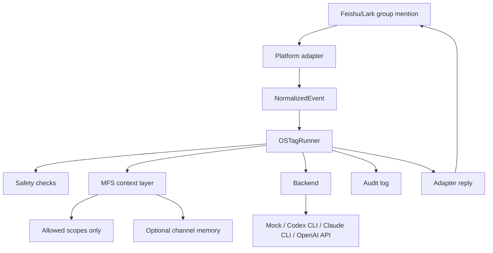
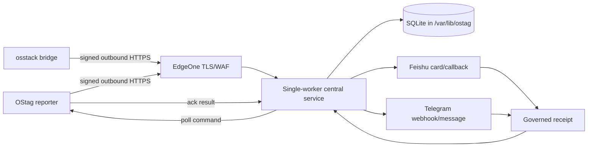

# OS Tag Architecture

OS Tag adapts the Open Tag idea to Feishu/Lark while keeping the agent runner
platform independent.

## Upstream Reference Summary

The upstream `zilliztech/mfs/examples/open-tag-skill` implementation is a Slack
Socket Mode bridge. It receives `app_mention` events, strips the Slack mention,
collects thread text, builds a prompt, optionally uses MFS helper scripts for
authorized context, invokes a CLI backend such as `claude -p` or `codex exec`,
and updates the Slack thread with the answer.

OS Tag keeps the useful pattern: Brain, Memory, and Tools. The key change is
that Feishu/Lark-specific logic ends at the adapter boundary. The core runner
only consumes `NormalizedEvent`.

## Core Boundaries

- `ostag/adapters/*`: platform event parsing, live transport, and replies.
- `ostag/core/event.py`: stable event contract.
- `ostag/core/runner.py`: mention filtering, safety, context retrieval, backend
  invocation, and audit logging.
- `ostag/mfs/client.py`: scoped context lookup.
- `ostag/mfs/memory.py`: optional Feishu/Lark chat-scoped markdown memory and
  explicit MFS sync helper.
- `ostag/backends/*`: model or CLI execution.

## Security Defaults

Dry-run is enabled by default. MFS is disabled by default. Shell execution and
unsafe CLI backend flags are disabled by default. Audit logs redact common API
keys and record full input text only in `OSTAG_ENV=dev`.

## Persistent work monitor

EdgeOne is only the HTTPS/WAF reverse proxy. The CVM/Lighthouse container owns
projection, receipts, the single scheduler, and outbox; SQLite remains on the
host persistent volume. Reporters never accept inbound control connections.

## Brief production lifespan

`work_monitor.server.create_app(..., brief_composition=TrustedBriefComposition(...))`
now constructs `BriefProductionOwner` inside the existing FastAPI lifespan when
`brief_enabled` is true. The owner controls the existing `BriefService`, one
`BriefWorker`, `CardDeliveryService`, `RetentionCoordinator`, and status writer
with **one `BriefLifecycle`**. The existing primary store is the queue. Its worker
executes both manual requests and the audited durable `meeting-brief-v1` path;
completed jobs receive retention registration and original private card delivery.
The integration does not recollect or promote archived meeting input.

All six flags still default off. All-off ignores even an injected composition and
starts only the existing disabled status owner, with no Brief persistence,
retention or worker. BRIEF supports explicit trusted host composition; MEETINGS
additionally requires BRIEF. HISTORY, ACTIONS, ROUTINES and SALES remain rejected.
Enabling BRIEF without the composition degrades Brief only. Monitor, relay and
daily owners retain their existing lifecycle and health behavior.

The composition is a frozen typed **Python host API**, not an environment-selected
factory, parsed authority file, HTTP request or bearer bypass. It requires the
current `TrustedBriefAuthority`, an `OpenAIReadOnlyTransport`, `CardTransport`,
pinned generation/inventory/retention configuration, authenticated identity and
installed-binding callbacks, explicit requester scopes and a host-attested image
digest. The owner checks current private destinations against the transport's
credential binding before initializing new stores. These concrete classes and
checks do not certify the host issuer: independently verified provisioning,
refresh/revocation and provider ingress remain outstanding production gates.
Neither event.raw nor model output supplies permissions or private destinations.

A private owned thread runs the business loop so synchronous SQLite, card policy
and transport callbacks do not block the Monitor event loop. The existing worker
retains model/lease execution. Every public application operation rechecks the
adapter identity before returning. Runtime OFF fences intake, claims and new IO;
actual in-flight work remains in custody. Shutdown joins owned work, retrieves
failures, and retains the persistence lock in a supervised finalizer if work is
still blocked. It never converts a timeout or missing PID into cancellation proof.
Failed thread creation also stays within Brief: a partially started worker joins
its completion thread before construction fails, and an unavailable business
thread leaves Monitor running without initializing Brief stores.

Business construction runs in an application-owned startup task after the bounded
status handshake, so the Monitor lifespan can serve while the five-store scan is
pending. Brief intake remains denied until readiness. Shutdown retains actual
construction and worker custody, including workers created concurrently with stop.

The status-directory flock is acquired first, then a lifetime persistence flock
at `<composition.directory>/owner.lock`, before any store constructor or runner.
Different status directories cannot share the same persistence directory. The
five fixed filenames are `brief.db`, `card.db`, `retention.db`, `revision.db`, and
`callback.db`. Protected paths, distinct file identities, schemas, sidecars and
retention target identities are checked. No migration occurs on reopen. Explicit
`initialize_new=True` allows initialization only when **all five files are absent**
in an existing mode-0700 directory; a partial initialization remains a blocker.

`startup_inventory.py` remains structural inventory. `startup_reconciliation.py`
adds bounded read-only cross-references across leases, costs, outbox/delivery,
original cards, callback bindings, original revision roots and retention targets.
Empty current schemas and correctly registered unclaimed/terminal jobs can reopen.
Started/unknown cost or delivery, unsettled reads, unfinished execution, prior
leases (including expired ones), reserved costs, missing registration, mismatched
identities, orphan records, partial retirement and revision event chains block
readiness. Callback records require a matching acknowledged original card. No
reconciliation path changes, releases, settles, retries or deletes durable rows.
Retirement receipts and revision chains currently require independent explicit
verification; their presence is not silently blessed. Schema versions 4/2/1/1/1
are the supported set; older schemas require an offline migration outside startup.
The scans are not a distributed atomic transaction: exclusion comes from the
cooperating owner and sealed lifecycle, not from file fingerprints.

This increment does **not** close A11, TD01, D02 or the frozen 31 remaining tasks,
9 debt groups and all 120 acceptance criteria. Authenticated signed recovery,
correction/adoption/withdrawal integration, provider issuer/ingress, host preflight,
multistore backup/restore/downgrade rehearsal, semantic evaluation and live pilots
remain separately evidenced gates. Existing meeting documentation and mandatory
Pandoc verification remain applicable.

The production owner's OFF reconciliation runs as one owned future on the business
loop. Status IPC continues at its existing deadline while publishing
`reconciliation_pending`, without a drain acknowledgement. A completed scan is
accepted only for the same control generation, within both its two-pass aggregate
scan budget and the 750 ms completion freshness window. Over-budget or failed
scans preserve observation and lock custody but quarantine reopening. Operator
control submissions during the scan are refused without advancing the generation;
a caller can retry after completion. Shutdown retains the owner until the actual
scan and finalizer finish. This is synthetic-tested lifecycle behavior, not live
provider activation evidence.
