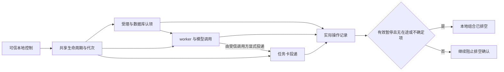

# A11c：暂停、恢复与真实在途操作

本轮将可信本地控制接入简报受理、worker 和任务卡路径。它承接 A11b 的权限状态，解决暂停后旧工作复活、公共 Future 已取消但后台仍在执行，以及本地停机被误报为排空的问题。

这是显式构造的本地业务组合，尚未接入生产 server 的启用路径。A11a 的默认关闭状态 owner 与此组合仍分离，不能用它输出的零计数证明本组合已经排空。生产开关仍默认关闭并拒绝开启。此前的授权、保留期与实际网络发送前检查继续生效。

## 行为与边界

控制默认关闭。可信应用代码按递增代次提交开关状态，操作绑定受理时的代次；暂停后再恢复只允许新操作，旧操作不会恢复权限。维护模式要求已有操作退出；进入后禁止新业务动作和清理写入。

在途记录跟随实际执行，包括受理线程、worker、模型与发送任务。公共 Future 完成、取消或本地线程停机不等同于实际工作结束。丢失完成证据的调用保留不确定状态，不能由一次恢复操作清零。分项记录可能重叠，例如一个 worker 同时持有一个模型调用；计数也包含永久保留的不确定项，不能相加当成独立任务数量。排空仅描述这一个本地组合已接管的操作，不证明远程调用被取消、持久队列为空或重启后没有未知支出。

保留期清理由显式受信调用触发，继续使用 A10 的删除记录和原始清理逻辑；本轮没有新增后台扫描器，也没有改变保留期限。在有效且非维护的控制状态下，不确定调用会阻止新业务，受控清理及取消仍可申请执行，但受同一容量上限约束。清理成功不会抹去不确定调用或使它满足排空条件。

新增 `BriefLifecycle`，通过 `apply(generation, admission, maintenance)` 更新可信本地控制，`snapshot()` 读取不可变状态，`shutdown()` 永久关闭该实例，`cleanup(coordinator, scope, job)` 执行受跟踪的 A10 清理。`BriefService` 和 `CardDeliveryService` 显式接受 `lifecycle`；worker 继承 service 的生命周期，同一实例只接纳一个 worker owner。没有默认数据库路径、配置读取或自动创建生产组合。

图中只表示显式本地调用路径，worker 不会自动触发卡片投递；自动调度仍需下一步生产 owner 接线。

## 接下来的实施顺序

1. 将可信权限更新器、库初始化与保留登记、这一生命周期组合接入单一生产 owner，处理启动失败与 Brief 域隔离。
2. 将 A11a 文件控制与业务计数绑定到同一 boot/generation；状态写失败立即关闭业务入口，禁止沿用无业务的零计数。验证进程重启、未知支出、孤立后台调用与维护模式。
3. 补齐经过认证的任务卡恢复、纠错、采用和撤回入口；保护控制目录挂载，安装受限主机控制命令和部署 preflight。
4. 完成 Feishu/GitHub 时间窗采集及 M05 会议准备，执行真实模型语义评测和独立 staging 验证，再进入发布验收。

每步验收条件与依赖见 [任务计划](TASKS.md)，真实模型与平台证据要求见 [验证方案](VALIDATION.md)，发布、激活和回滚操作见 [部署方案](DEPLOYMENT.md)。这些原有放行条件继续适用，不以本轮测试通过替代。

| 后续步骤 | 开发落点 | 必须验证的结果 | 部署条件 |
| --- | --- | --- | --- |
| 可信权限更新 | `authority.py` 的受信调用方，身份/来源/grant/私聊目标更新入口 | 开始读取和解析前使旧状态失效；读取失败、过期、撤权、身份或目标变化均拒绝继续；不从 `event.raw` 或模型输出取得授权 | 先明确配置、凭据与发行方，完成隔离环境身份验证 |
| 单一生产运行实例 | `runtime.py`、服务 lifespan 与显式组件工厂 | 全关不打开业务库、不启动 worker；启用只创建一个 owner；保留登记在派发前完成；启动或 schema 错误只使 Brief 域退化，Monitor/relay/日报继续可用 | 默认全关，迁移另行执行；未经兼容验证不得自动打开新库 |
| 控制与真实状态接线 | A11a 控制读取/状态发布与 `BriefLifecycle` | 暂停在 SQLite 与网络等待后仍有效；旧 boot/generation、状态写失败、非零或不确定操作不能形成排空 ACK；新进程先核对遗留执行/投递证据 | 使用受保护目录，不能把旧的零计数状态当作业务排空证明 |
| 认证入口与维护模式 | 卡片恢复、revision 操作路由与只读业务库检查 | 身份/目标/原消息绑定、旧 revision 拒绝、重复回调不重复执行；同一镜像维护模式不产生业务写入、模型或平台 IO | 隔离飞书应用/用户/群验证，覆盖移动端与桌面端可用性 |
| 发布与回滚前置检查 | 受限主机控制命令、Compose 挂载与既有发布 wrapper | CI 身份只能关闭；人工激活绑定独立可信身份；确认本次 boot/generation 的新鲜排空证据；回滚始终恢复全关 | 先完成 staging、恢复演练和 D01/D02，再按原发布流程放行 |

这些步骤仍属于原任务计划；本轮本地验证不能替代真实飞书身份/ACL、真实会议资料、腾讯服务器或生产验收。

## 审计保留的非阻断限制

- worker 只读检查之后的 `idle` 回报没有再次检查代次，因此暂停后可能收到稍晚的空闲回报；它不包含私有内容，也不会发起 IO 或修改任务。生产状态桥接必须使用当前控制与实际操作记录，不能把这个字符串当作排空 ACK。
- 不确定记录永久占用容量，默认总容量为 64；容量用完时，清理和取消也不能申请新操作。生产运行需要明确处理容量告警和经过核对后的组合重建，不能通过清零计数解除未知执行。后续 owner 接线应验证此资源耗尽场景及受控恢复路径。
- 卡片拒绝路径依赖现有 `SchemaError` 的异常继承关系；本轮回归已覆盖对应错误转换。Kimi 的原始意见原样保留在审计回执中。

## 已取得的本地证据

代码提交 `3a7e85dd9ce179c93aaf1f9d492616d265b64af1`，候选 SHA256 `2eae0337946e9a810e5dfe3ece556eb97f0d9e360d7612e6e8a4559a822f1429`。

- macOS：定向 469 项、全量 3240 项通过，11 条既有警告。
- 隔离 Linux ARM64：定向 469 项、全量 3240 项通过，11 条既有警告。不代表 Ubuntu x86_64 CI 或腾讯生产验证。
- 两端各 25 组固定独立探针通过；Ruff 和锁文件检查通过。
- Kimi K3 实际会话批准，无阻断；完整读取覆盖 46/46，核对工具实际返回行内容，无截断计入。Kimi 未执行测试。
- 独立父探针验证取消受理仍保留后台 custody、暂停恢复不复活旧受理，以及 worker Future 已 stopped 时仍不可声称模型排空。

[准确验证记录](reviews/a11-lifecycle-validation.json) · [实际Kimi审计回执](reviews/a11-lifecycle-kimi-k3.json)
