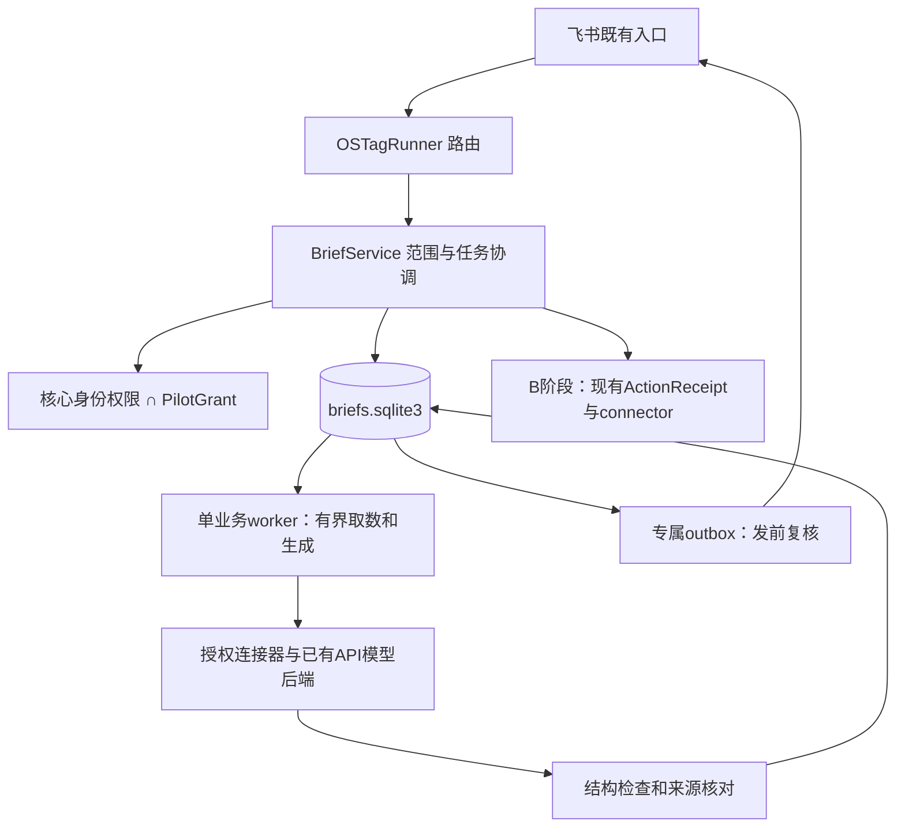

# OStag 公司助理：开发、测试、验证与部署实施方案

最新：A11d 已将文件控制与状态发布接到真实本地生命周期，暂停禁止新增清理/取消，控制有效期在事件循环停顿时仍可自行失效；Codex 编码、Kimi K3 审计批准，macOS/Linux 全量各 3262 项通过。见 [控制状态接线与下一步](A11-CONTROL-BRIDGE.md)。附加状态不会发出生产排空 ACK；遗留执行核对、生产 owner、可信权限更新、会议采集与部署仍待完成。

初版规划日期：2026-09-13；下文规划与当时基线作为历史保留，当前实现以最新执行状态为准。所有拟议上线指标仍须逐项取得证据，本地通过不代表生产验收。

## 本轮增强：会议准备与OpenTag增量

用户新增要求已纳入：基于Feishu CLI聊天与osborn-studio指定时段GitHub变化准备会议，并吸收OpenTag适用新能力。当前40任务、120条验收；新增会议profile在A2后、B前独立放行，上游写入增强与会议只读解耦。功能详细规格以[会议准备](MEETING-PREP.md)为准；[上游增量映射](UPSTREAM-SYNC.md)、[来源](SOURCES.md)和[开发入口](DEVELOPMENT-START.md)一并更新。既有Q套件和新MC套件分别验收。

## 目标与交付范围

首批让用户本人在飞书私聊交办“准备这次项目周会”，得到有来源的进展、资料冲突、待决定事项与行动建议；可以纠正、保存和继续。随后将确认过的行动落实到原业务系统，并核对结果。最后用销售文字跟进验证复用能力。

发布批次：A1手工材料简报、A2授权历史简报（分别验收）；M双源会议准备；B确认后的窄写回与例行任务；C销售文字跟进；U其余上游适配独立发布。A1不能代替A2完成；A2开发不必等待A1整段试点。阶段内每2—3个任务作一次检查点，阶段间以证据放行。

[任务与依赖](TASKS.md) · [测试和真实验收](VALIDATION.md) · [部署与回滚](DEPLOYMENT.md) · [双模型与osstack协作](COLLABORATION.md) · [Fable挑战与决策](REVIEW.md) · [机器可读backlog](backlog.json)

## 当前基线与计划变化

- 远端main与新计划worktree均为 `b73dc1d9709a4924b7928b8d7ebe9ef171720ff4`，包版本0.5.0。主目录仍是旧功能分支5098f914，不直接在其上继续产品开发。
- 公司计划d2a09920、M0 8b0dd3d9、PR evidence f62b68a5保留；历史46项规划作为能力地图，不自动批量合并或运行。
- 本轮在main快照复跑：1121 passed、11 warnings、21.63秒；Ruff通过。使用已有Python3.13.13环境，不是Python3.11 locked新装，也不是release/平台/生产验收。
- osstack0.19.0 doctor发现新worktree仍有13个历史任务，daemon未查、队列未启动；CLI成功不证明可以安全执行。
- 本机lark-cli1.0.56帮助使用`--order`；生产Dockerfile固定1.0.69。实现前测试两个目标版本的契约，不照搬技能文档中的`--sort`。
- 现有server lifespan已接OSTagRunner与FeishuAdapter，不需另起一个生产bot消费者。auto_base的5页历史搜索仅用于寻找docx/Base上下文，不是完整会议时间窗读取。

相对旧计划，M1会前简报优先；M2/M3按“确认行动→原表/任务”共享写入能力合并安排；M4插件生态、M5通用私有电脑/合同和M7语音多Bot暂不在此次承诺范围。已有云M0证据保留，首批API模型简报不以通用电脑运行时为前提。PR只读证据为独立线，不阻塞A。

## 用户可见流程

1. 私聊发“准备项目周会”或贴材料。OStag呈现目标项目、日期区间、已授权资料及输出接收者，不要求用户懂模型或数据库。
2. 返回受理卡和稳定任务编号；后台取数与生成。用户可查看状态、取消、补资料。
3. 草稿含四区：有依据进展、冲突、需要决定、建议行动。每个关键结论可回查来源；未读全、媒体未解析、无法核验要明确。
4. 用户纠正产生新版本；“采用这个简报”只登记内容验收。“确认一个行动”在B才产生独立变更提议与审批回执。
5. 已授权写入完成后读回；失败或不确定分别显示。订阅由用户选择经验证的模板、资料范围、接收人、时区与频率。

A默认只给请求者私聊预览；群内交办可回复一条不含资料的状态，并引导到授权私聊。源群成员身份、机器人能读和输出受众可见是不同检查。首批不跨人员共享私人历史；A的“待决事项”是卡片区，不是第二套审批系统。

## 架构方案



**采用独立业务SQLite，不升级Monitor schema。** 路径拟为`/var/lib/ostag/briefs.sqlite3`，同中央服务拥有，遵循已有workstreams独立存储先例。只保存brief任务、来源、版本、内容验收与业务outbox；身份和ActionReceipt仍由现有系统掌握。它不是新控制平面。

原因：MonitorStore按user_version拒绝新版数据库，增加迁移会让旧镜像回滚失败。A新增业务库可让旧镜像继续运行既有Monitor，保留brief库等待前向恢复。新增存储仍需独立备份、保留与兼容规则，不能认为分库自动解决跨系统事务。每版manifest声明brief可读schema区间；迁移只前向。旧版遇到更高brief schema只停brief域并上报degraded，不抛出lifespan使旧业务停机。需要查看新版brief数据时用原digest的只读维护模式，不能强行降schema。

初版拟议模块如下，当前实现情况见EXECUTION.md：`ostag/briefs/`下models/grants/store/service/worker/validation/rendering；`ostag/connectors/brief_sources.py`提供只读资料契约。保留frozen dataclass与显式严格解析风格；不全仓改pydantic，不为A新增框架或向量库。

协议示意（需在A01固定v1语法与负例）：

```python
@dataclass(frozen=True)
class SourceRef:
    source_id: str
    resource_id: str
    observed_at: str
    content_sha256: str
    grant_revision: int
```

真实契约还需命名空间、资源版本（缺失标unknown）、时间窗、来源类型、可见范围、purpose/audience和有限excerpt。模型只输出source_id引用，URL由连接器可信资源映射生成；hash证明输入一致性，不证明内容真实性。

## 最小数据与一致性契约

| 对象 | 必要语义 |
|---|---|
| PilotGrant | namespace/actor、资源列表、用途、输出受众、模型出网、有效期、revision、撤销时间；由可信配置管理，模型与普通用户不可自授 |
| BriefJob | job/run/attempt、输入hash、grant revision、状态、lease/fence、时间与预算；receipt引用可空，不能自称已批准 |
| SourceSnapshot | 采集身份、来源ID、时间窗、采集时间、版本/摘要/hash、分页和缺口；禁止把partial转换成complete |
| BriefRevision | 冻结来源集合、模型实际身份、prompt/预算集/验证规则版本、config hash、结论/冲突/建议、验证结果、parent revision |
| Acceptance | actor、brief revision、采用/要求修改、时间；用户采用内容和业务审批分开 |
| Delivery | destination、revision、delivery_id、状态、provider message ID/不确定结果、发送前授权revision |

作业接收与入队同事务；草稿版本与待投递事件同事务；job推进和fence检查同事务。Outbox先持久记录意图，再执行外部发送，结果回写。网络发送与SQLite不可能原子，回应丢失必须进入uncertain，不以再次发送“修复”。

一个lifespan owner认领brief作业（并发1），不与Monitor/日报outbox混领。数据库操作短事务，模型请求不持SQLite锁。API调用用有界异步或专用线程/进程并设超时，不占据Monitor事件循环。第一期预算建议：500条消息、100条表记录、7天时间窗、输入1MiB/请求；thread展开计入500总预算；作业认领后取数与生成共用180秒总墙钟（包含全部重试），最多初次加2次仅针对确定可重试的只读/模型失败；队列待执行最多20，超限明确拒绝并提示稍后。均为试点初值，启动前按代表性样本校准，不能静默截断。预算集（含每任务成本上限）、prompt、验证规则、模型实际身份组成不可变评测参数版本，进入config hash与BriefRevision；不同评测参数版本不混算。每日成本上限只进入config hash与审计，不进入单任务评测可比性键；日限额导致的拒绝/缺测仍单独报告。排空最长180+30秒，不能因重试重置deadline。

状态：queued→collecting→generating→draft_ready；needs_input/failed/cancelled为明确分支。投递状态独立于草稿生成，生成成功不等于用户收到。取消后停止新读取/模型调用/投递；旧fence不能提交。已在途外部操作必须标记结果待核验，不能承诺取消会撤回已发内容。

**授权是新增的最小业务约束。** 既有actor/channel权限不包含完整资源、用途、受众和撤销语义，A01必须补PilotGrant并与旧权限取交集。每次出网/资料读取/最终提交/投递前重查当前grant；grant变化使待执行任务重新验证或暂停，不能只在入口检查。A1同样需要明确材料用途和模型出网。

资料保留拟议默认：用于模型的有界脱敏摘录7天；最少审计元数据/作业结果30天；用户显式保存的简报另选保留政策。全文原始抓取默认不持久化，隐私日志关闭。默认摘录7天是待资料owner确认的建议，不是凭空扩大保留范围。临时内存/中间文件应按任务结束即清理；多源撤销使整版失效，不自动用剩余源再出网。已送provider的prompt不能技术撤回。去重hash不能代替删除原文；来源撤回和grant撤销清除/阻断相关缓存、生成材料和未发送产物，保留无内容tombstone。过期后来源标hash-only/不可重验，不能继续显示“已核验”。数字须由试点资料owner确认，未确认可用合成材料开发。

## B阶段写入边界

冻结一个目标、原值、新值、字段白名单、资源版本与实际执行身份，用现有提议→审批→执行机制；新字段若现有schema拒绝则做显式版本化，禁止偷塞未知key。审批签名绑定内容和目标，改动后重审。

现有ActionReceipt经JSONL RunLedger持久化，不是另一SQLite库。brief库只引用核心receipt，不能复制approved布尔值作为授权。跨库receipt创建、apply结果与brief状态更新必须通过可幂等查询的关联ID对账；崩溃后查权威receipt和外部系统，无法唯一关联就停在reconciliation。不能宣称跨库事务。

无真实CAS/供应商幂等时不保证恰好一次。应用内单writer不能阻止人手编辑原表，禁止以此冒充全局写锁。首个写入只在测试表中证明条件更新或明确附加型操作安全；真实表不具备条件写时，冲突敏感覆盖保持待确认/人工操作。任务创建响应丢失同样先核对，不自动再创建；不暗加隐藏幂等字段，不锁住原表人工编辑。

## 规划排期、职责和决策点

按任务依赖推进，先运行P00、A01与一个A1纵向切片。每2—3任务复盘实际用时、通过/缺证据、下一小切片；取得前3个任务的实测速度后再给日历交付预测。真平台权限、真人验收和7天试点不能用模型生成速度替代。

用户是产品owner和首位验收者；Codex负责主实现与确定性核查；Fable负责独立挑战和评审，可按切片互换；发布操作者使用现有腾讯部署身份；资料owner确认资源和接收者。没有指定成员的任务不擅自分配给陈利娜/左士文。

本方案选择飞书私聊、同中央服务、独立brief库、单并发、先API模型。待实施前补齐的配置是试点资料/接收者/出网与保留、B原表字段及身份、生产窗口和限额。这些仅限制相关真实读取/写入/上线；不要求一次回答全部后续问题，也不阻塞合成开发。不因旧计划D0—D7尚未更新就重复询问用户已经给出的决定。

## 实施前新增的窄修订

A02/A04增加30秒租约、10秒心跳、所有结果提交/投递前fence检查与重启快照有效性复核。D02增加部署排空和新业务库备份/恢复；A不改变Monitor schema不等于可以在active job中强行切镜像。生成后的数字核验只针对明确的统计字段/关键事实槽位，并与人工语义核对配合；不通过“所有字符都曾出现”判定正确。详细故障、权限和复盘要求以VALIDATION/DEPLOYMENT为准。


## 源码核对入口

本轮事实来自当前main源码与CLI帮助；以下相对路径均属于仓库，供实现时再次核对：server.py生命周期接线、work_monitor/store.py迁移拒绝降级、core/workstreams.py独立SQLite、core/run_ledger.py与approvals.py的receipt持久化、workflows/auto_base.py的受限历史定位、scripts/release_check.sh、.github/workflows/ostag-ci.yml、.github/workflows/deploy-production.yml、deploy/work-monitor/Dockerfile与发布脚本。

飞书官方入口：[读取聊天历史](https://open.feishu.cn/document/server-docs/im-v1/message/list)、[消息发送](https://open.feishu.cn/document/server-docs/im-v1/message/create)。本轮网页正文未能抽取，参数细节依据本机CLI实际help与仓库实现；正式实现必须用目标镜像CLI/API schema复核，不能把这些链接当已完成平台实测。
